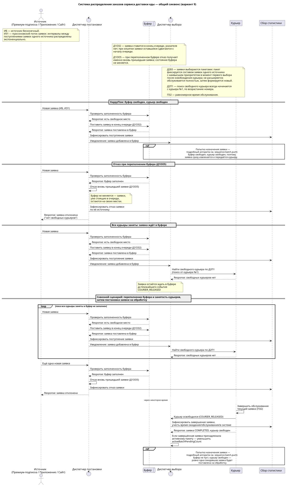
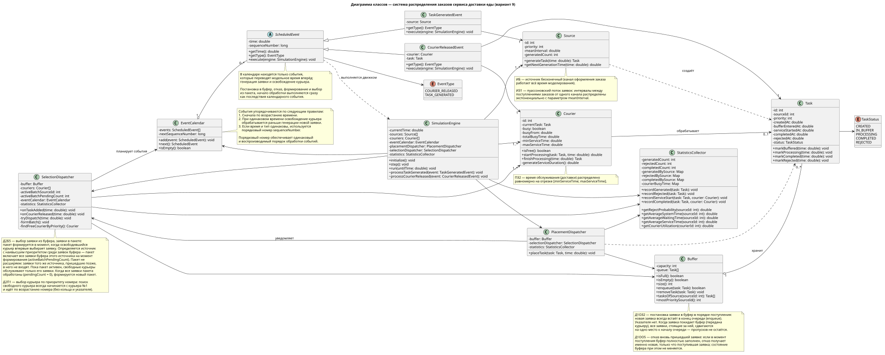
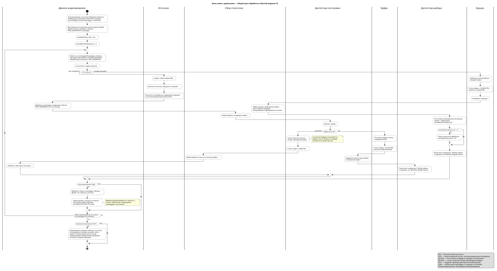
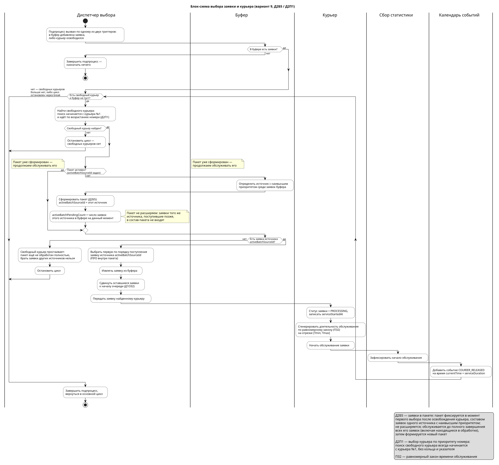

# Система распределения заказов сервиса доставки еды — вариант 9

**Карякин Платон Евгеньевич · группа 5130904/40102**

Первичные артефакты курсовой работы по имитационному моделированию СМО.
Несколько каналов оформления заказа (Премиум-подписка, Мобильное приложение,
Веб-сайт) независимо отправляют заявки в общий ограниченный буфер
диспетчерской. Свободные курьеры обслуживают заявки пакетами одного канала.
Репозиторий содержит проект модели: диаграммы, правила и сценарии для защиты.

## Формула варианта

`ИБ | ИЗ1 | ПЗ2 | Д1ОЗ2 | Д1ОО5 | Д2П1 | Д2Б5 | ОР1 | ОД3`

| Код | Правило в модели |
| --- | --- |
| ИБ | Бесконечные источники: каналы продолжают генерировать заявки независимо от их обслуживания |
| ИЗ1 | Пуассоновский поток каждого источника; интервалы поступления распределены экспоненциально |
| ПЗ2 | Время доставки — равномерное распределение U(Tmin, Tmax) |
| Д1ОЗ2 | Запись в конец общей очереди буфера; после извлечения заявки оставшиеся сдвигаются к началу |
| Д1ОО5 | При полном буфере отказ получает именно вновь пришедшая заявка; ранее принятые не вытесняются |
| Д2П1 | Каждый поиск свободного курьера начинается с №1; выбирается первый свободный по возрастанию |
| Д2Б5 | Заявки выбираются пакетами: пакет фиксируется составом заявок источника с наивысшим приоритетом на момент формирования и не расширяется |
| ОР1 | Автоматический режим: сводные таблицы статистики |
| ОД3 | Пошаговый режим: табличный календарь событий и текущее состояние компонентов, без временной диаграммы |

Номер источника задаёт приоритет: **1 — Премиум-подписка, 2 — Мобильное
приложение, 3 — Веб-сайт**. Кольцевых указателей в варианте нет. Порядок
внутри пакета — FIFO (по времени поступления).

## Бизнес-домен и маппинг

| Элемент СМО | Элемент системы доставки |
| --- | --- |
| Источник | Канал оформления заказа |
| Заявка | Заказ на доставку |
| Буфер | Общая ограниченная очередь диспетчерской на N заданий |
| Прибор | Курьер, обслуживающий одно задание без прерывания |
| Диспетчер постановки | Приём заказа, запись в очередь или отказ |
| Диспетчер выбора | Формирование пакета и назначение его заявок свободным курьерам |
| Обслуживание | Доставка заказа |
| Выход | Доставленный либо отклонённый заказ |

Подробно: [бизнес-домен](docs/business-domain.md), [маппинг](docs/mapping.md).
Рабочие документы: [бизнес-домен DOCX](docs/source/business-domain.docx),
[маппинг DOCX](docs/source/mapping.docx).

## Правила, общие для всех диаграмм

Диспетчер постановки всегда сначала работает с буфером и не знает о
состоянии курьеров. После успешной записи модель вызывает диспетчер выбора;
второй триггер выбора — освобождение курьера. При свободном буфере и
курьере заявка записывается и сразу извлекается в тот же момент модельного
времени, без ожидания.

Пакет содержит фиксированный набор заявок одного источника, находящихся в
буфере на момент его формирования. Новые заявки того же источника пакет не
расширяют. Все курьеры обслуживают только текущий пакет; следующий
формируется после завершения всех его заявок, включая те, что уже
находятся на обслуживании. Если ожидающих заявок пакета больше нет, а
обслуживание ещё идёт, свободные курьеры простаивают.

Полные алгоритмы, формулы и трактовка спорных мест методички —
в [правилах модели](docs/model-rules.md).

## Первичные артефакты

### 1. Общая диаграмма последовательности

Генерация, успешное размещение, отказ при переполнении, занятость курьеров,
выбор из пакета, назначение и завершение доставки.

[PlantUML](docs/diagrams/sequence-main.puml) · [PNG](docs/diagrams/sequence-main.png)

### 2. Диаграмма классов

Поля, методы, приватные ссылки диспетчеров на компоненты и типизированные
связи между классами.

[PlantUML](docs/diagrams/classes.puml) · [PNG](docs/diagrams/classes.png)

### 3. Блок-схема с дорожками

Общая схема обработки событий и подробная схема выбора вместе показывают
все альтернативы варианта: полный буфер, отсутствие свободных курьеров,
пустой буфер, активный пакет без ожидающих заявок, формирование и
закрытие пакета.

[PlantUML](docs/diagrams/flowchart.puml) · [PNG](docs/diagrams/flowchart.png)

[PlantUML алгоритма выбора](docs/diagrams/flowchart-dispatch.puml) · [PNG](docs/diagrams/flowchart-dispatch.png)

### 4. Отдельные сценарии последовательности

| Сценарий | Изображение | Исходник |
| --- | --- | --- |
| HappyFlow: буфер и курьер свободны | [SVG](docs/diagrams/sequence-happy.svg) / [PNG](docs/diagrams/sequence-happy.png) | [PlantUML](docs/diagrams/sequence-happy.puml) |
| Отказ новой заявке при переполнении | [SVG](docs/diagrams/sequence-overflow.svg) / [PNG](docs/diagrams/sequence-overflow.png) | [PlantUML](docs/diagrams/sequence-overflow.puml) |
| Выбор пакета, выборка, назначение и ожидание | [SVG](docs/diagrams/sequence-batch.svg) / [PNG](docs/diagrams/sequence-batch.png) | [PlantUML](docs/diagrams/sequence-batch.puml) |

## Материалы для защиты и проверки

- [Сценарии, пример состояний и табличный календарь](docs/scenarios.md).
- [Соответствие требованиям первичных артефактов](docs/requirements.md).
- [Навигация по диаграммам](docs/diagrams/README.md).
- [Проверка и рендеринг](tools/README.md).

Готовые SVG и PNG включены в репозиторий. Все `.puml` самостоятельны
(UTF-8, без внешних `!include`). Для повторного рендеринга после правок —
`tools/render_diagrams.py` или `plantuml.jar`, см. [tools/README.md](tools/README.md).
Что именно проверено в опубликованных изображениях — в [docs/verification.md](docs/verification.md).

## Границы этапа

Это этап проектирования до реализации программы. Эксперименты, экономическое
обоснование, оптимальная конфигурация и численные результаты появятся после
реализации и запусков модели. Здесь определены правила сбора статистики и
отображения, но экспериментальные значения не заявляются. Временная
диаграмма и нотация ArchiMate не включены: памятка не требует первую и
делает вторую опциональной.
